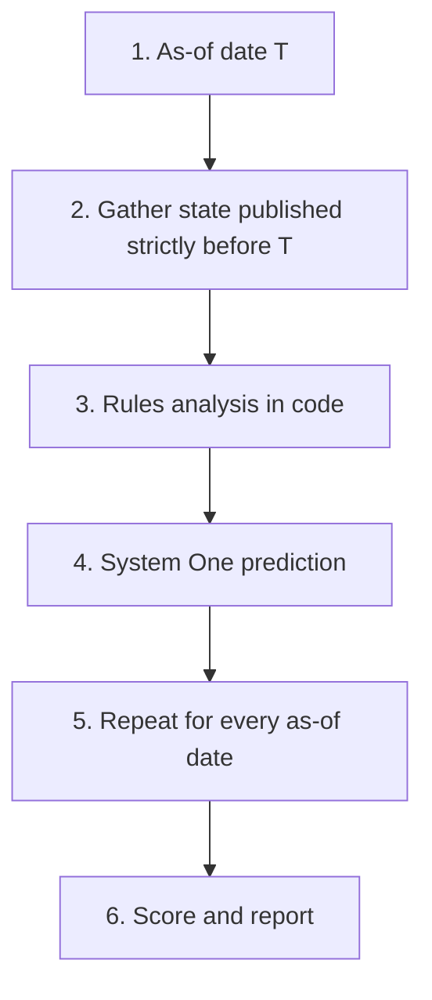
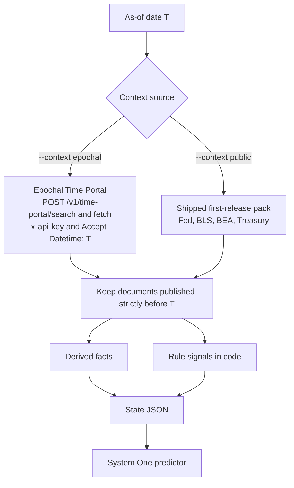

# epochal-pilot

[](https://github.com/sgarrepalli27/epochal-pilot/actions/workflows/ci.yml)
[](LICENSE)


**Backtest and forecast agents as of any date, with leak-aware context so the future cannot sneak into the prompt.**

`epochal-pilot` is an evaluation harness, not an API wrapper. Pick a System One predictor, supply your
own key, and run the same pipeline on history (backtest) or on events that have not resolved yet
(live forecast). The flagship scenario, [`fed-quarterly`](scenarios/fed-quarterly), forecasts the
FOMC target range at quarter-end from each as-of date T.

## Get started

Python 3.10+. Clone, create a venv, install, and copy [`.env.example`](.env.example) to `.env`
(gitignored). `epochal-pilot check` shows which keys are set, never their values.

Set **one** System One key for predictions — `TYPESAFE_API_KEY`, `OPENAI_API_KEY`, or `GEMINI_API_KEY`
(`GOOGLE_API_KEY` is accepted as a Gemini fallback). `EPOCHAL_API_KEY` is needed only for
[`--context epochal`](#where-the-data-comes-from---context-public-vs---context-epochal). System Two
keys (`OPENROUTER_API_KEY`, `ANTHROPIC_API_KEY`) are optional and used for `--analyst` rationales.
No key is required for `--backend rules`, `--backend ollama`, or `--backend claude-cli`.

The default predictor is `jev-rules` when `TYPESAFE_API_KEY` is set, otherwise `rules`. The first
command below uses the shipped public pack and spends **0 Epochal requests**.

### Windows (PowerShell)

```powershell
git clone https://github.com/sgarrepalli27/epochal-pilot.git
cd epochal-pilot
py -m venv .venv
.\.venv\Scripts\Activate.ps1
pip install -e .
Copy-Item .env.example .env
# Edit .env and add one System One key (optional: EPOCHAL_API_KEY, System Two keys).
epochal-pilot check
epochal-pilot run fed-quarterly --context public --only fq_2022q1
epochal-pilot report --latest
```

### macOS / Linux

Same steps, but create the venv and copy `.env` with
`python3 -m venv .venv && source .venv/bin/activate && cp .env.example .env`.

No keys at all? `epochal-pilot run fed-quarterly --dry-run --context public --only fq_2022q1` walks
the pipeline with a mock predictor. More setup: [docs/what-you-need.md](docs/what-you-need.md).

## How it works

The official pipeline keeps analysis in code and uses a System One predictor only for the judgment.

1. Pick an as-of date T.
2. Gather state published strictly before T (public pack or a time-portal API).
3. Analyse that state against business rules **in code** (inflation gap, labour, SEP gap, tone, shocks).
4. Ask a System One predictor for a distribution (`jev-rules` always includes the rule analysis; others use `--with-rules`).
5. Repeat for every as-of date.
6. Compare to ground truth and write the report (table, analysis, p(true) timeline, calibration).

`--backend jev` skips step 3 and omits rule analysis from the state. `--backend rules` stops after
step 3 and maps the same signals to a distribution with no model.



## Modes

| Mode | Command | When it scores | What it tests |
|---|---|---|---|
| **Backtest** (default) | `epochal-pilot run fed-quarterly --context public` | Immediately, against the answer key | 43 as-of dates (2016–2026) and, optionally, 10 `turning-point` dates |
| **Forecast (live)** | `epochal-pilot run fed-quarterly --mode live --context public` | After the quarter ends, in January, via `epochal-pilot score --latest` | The unresolved event (2026 Q4: as-of 15 Nov 2026, target 31 Dec 2026) |

Both modes share the six steps. To score a `fed-quarterly` live forecast, add any FOMC change to
`scenarios/fed-quarterly/fomc_changes.csv`, run `python tools/build_fed_quarterly.py events`, then `epochal-pilot score --latest`.

## Model choices

**System One** is the recommended predictor: a typed choice over the option set, with a probability
for every bucket. Pick one provider and supply your own key. **System Two** models are for analysis —
`--analyst {openrouter,anthropic,ollama,claude-cli}` attaches a rationale *after* the forecast and
does not change probabilities (they remain valid `--backend` values, but not the recommended
default predictor). **Rules** (`--backend rules`) is a no-model baseline: the same in-code checklist,
mapped to a distribution, honest about 2016–2026 hindsight.

TypeSafe Jev (`--backend jev` and `jev-rules`) has been tested live against the TypeSafe API.
`--backend openai-decisions` and `--backend gemini-decisions` have only been tested against
mocked or simulated responses and have not yet been run live. Prices below are as of 2026-11-26
and are linked to the official page that states them.

| Provider | `--backend` | Role | Key | Default model | Notes |
|---|---|---|---|---|---|
| TypeSafe Jev | `jev-rules` | System One (recommended default) | `TYPESAFE_API_KEY` | [`jev-latest`](https://docs.typesafe.ai/models) | Official pipeline: code analysis, then Choice. Default when the TypeSafe key is set. Input $0.042 / 1M tokens; output free (as of 2026-11-26; [TypeSafe models](https://docs.typesafe.ai/models)). TypeSafe documents that Jev is [trained to return calibrated decisions](https://docs.typesafe.ai/models). Tested live. |
| TypeSafe Jev | `jev` | System One | `TYPESAFE_API_KEY` | [`jev-latest`](https://docs.typesafe.ai/models) | Choice on as-of context only (no rule analysis unless `--with-rules`). Same model, price, and live testing as `jev-rules`. |
| OpenAI Decisions | `openai-decisions` | System One | `OPENAI_API_KEY` | [`gpt-6-luna`](https://developers.openai.com/api/docs/guides/decisions) | Official [Decisions API](https://developers.openai.com/api/docs/guides/decisions) (`POST /v1/decisions`). Uncached input $0.10 / 1M tokens; output not charged (as of 2026-11-26; [Decisions guide](https://developers.openai.com/api/docs/guides/decisions), [pricing](https://developers.openai.com/api/docs/pricing)). Official docs describe probability estimates and do not claim they are calibrated. Tested only against mocked/simulated responses, not yet run live. |
| Gemini Decisions | `gemini-decisions` | System One | `GEMINI_API_KEY` or `GOOGLE_API_KEY` | [`gemini-decision-1`](https://aistudio.google.com/docs/models/gemini-decision-1) | Official [Decisions API](https://aistudio.google.com/docs/decisions-api) (`x-goog-api-key`). Paid input $0.10 / 1M tokens; output not applicable (0 output tokens); free tier free of charge (as of 2026-11-26; [pricing](https://aistudio.google.com/docs/pricing), [model page](https://aistudio.google.com/docs/models/gemini-decision-1)). Official docs state that the API [returns calibrated probabilities](https://aistudio.google.com/docs/decisions-api). Tested only against mocked/simulated responses, not yet run live. |
| Rules checklist | `rules` | Baseline | — | `rules` | No model. Default when no TypeSafe key is set. |

`--backend openai` and `--backend gemini` are schema-locked LLM fallbacks, labeled “not
calibration-trained” (`--structured-api responses` or `chat` for OpenAI). System Two backends
(`openrouter`, `anthropic`, `ollama`, `claude-cli`) are listed with setup notes in
[docs/what-you-need.md](docs/what-you-need.md). Add `--with-rules` to include the in-code checklist
in any System One state (`jev-rules` always does this), or `--model` to override the default model
id. To add a provider, see [docs/adding-a-provider.md](docs/adding-a-provider.md).

## Where the data comes from: `--context public` vs `--context epochal`

Both sources freeze what the predictor may read at as-of date T. They do not freeze the model itself
(see [Leak checks](#leak-checks)).

| | `--context public` | `--context epochal` |
|---|---|---|
| What it is | A shipped first-release pack of US-government documents, frozen in the repo (Fed, BLS, BEA, Treasury). Only the latest document of each kind published **strictly before T** is used. | Live date-gated web search and fetch through the [Epochal Time Portal](https://epochal.com): `POST https://api.epochal.com/v1/time-portal/{search,fetch}` with `x-api-key` and `Accept-Datetime: T`. Results published at or after T are dropped. |
| Key | None | `EPOCHAL_API_KEY` (get it at [epochal.com](https://epochal.com); Epochal currently serves US traffic only) |
| Cost | 0 Epochal requests | 1 search per as-of date, then cached (reruns with other backends spend nothing extra). Free tier: 100 requests per account. This run: `--budget` (default 10 new requests). This cache: `--max-total` (default 90, a margin under the free cap). `--plan-queries` and `--max-fetches` can add requests. Run `--estimate` before you spend. |
| Coverage | Fixed pack: **307** first-release docs for `fed-quarterly` (a smaller pack ships with `fed-rates`) | The open web as archived before T |
| Leak protection | Documents enter the state only if released strictly before T. The pack is frozen in the repo, so it cannot pick up later revisions. | Every request is gated on T (`Accept-Datetime: T`); later results are dropped. |
| Default | **Yes, for System One backends** (`jev-rules`, `jev`, `openai-decisions`, `gemini-decisions`, `rules`, and the `openai` / `gemini` fallbacks). | Default only for System Two `--backend` values (`openrouter`, `anthropic`, `ollama`, `claude-cli`). Pass `--context public` if you do not want to spend requests. |
| When to use | Everyday default: no key, no spend, and the pack covers every `fed-quarterly` as-of date. | When you want the open web as it was before T (news and shocks beyond the fixed pack). Estimate first. Optional extra for a live forecast. |

```bash
# Public pack (0 requests). Already the default for System One backends.
epochal-pilot run fed-quarterly --context public --only turning-point
epochal-pilot report --latest

# Epochal Time Portal: estimate, then run (1 search per as-of date; 10 turning points).
epochal-pilot run fed-quarterly --context epochal --only turning-point --estimate
epochal-pilot run fed-quarterly --context epochal --only turning-point
epochal-pilot report --latest
```

For a live forecast, add `--mode live` to either `run` (and `--estimate` before spending Epochal
requests), then score later with `epochal-pilot score --latest`.

To compare the two sources, run the same events (`--only turning-point` is the 10-request subset)
with each flag and compare the reports:

```bash
epochal-pilot compare runs/<public-run> runs/<epochal-run>
```

Share metrics only. Do not publish Epochal results (cached responses, URLs, titles, snippets, or page
text). Derived facts (SEP gap, remaining FOMC meetings) and in-code rule signals are then attached to
the state JSON; see [docs/building-state.md](docs/building-state.md) for an example and another time-portal hook.
Budget ledger and caps: [docs/commands.md](docs/commands.md#budget).



## Leak checks

The as-of context cannot contain the answer, but a model trained after the event may already know it. Live forecasts sidestep that problem. For backtests:

| Check | Flag | What it does |
|---|---|---|
| Blind | `--no-context` | Same question with the as-of date and current policy range only. No documents, derived facts, or rule analysis. 0 Epochal requests. Overrides `--context`. |
| Date masking | `--mask-dates` | Keeps the documents but rewrites calendar years relative to T (`Year 0`, `Year -1`, …). |
| Pre/post cutoff | report split; `--cutoff MODEL=YYYY-MM` | Accuracy is split at the model's training cutoff ([models.json](src/epochal_pilot/models.json)). Accuracy that holds after the cutoff is skill; a collapse suggests memory. |
| Gated vs ungated | `--modes gated,ungated` | Compare answers with as-of context vs memory only. |

Worked commands and how to read a gap: [docs/leak-checks.md](docs/leak-checks.md).

## Scenarios

| Scenario | Events | Question | Context |
|---|---|---|---|
| [`fed-quarterly`](scenarios/fed-quarterly) | 43 quarter-ends (2016 Q1–2026 Q3) + 1 live (2026 Q4) | Net change in the FOMC target range by quarter-end (8 buckets) | Public first-release (0 requests) or Epochal (1 per T) |
| [`fed-rates`](scenarios/fed-rates) | 23 FOMC meetings, Jan 2024–Oct 2026 | Hold / cut / hike at that meeting | Public pack or Epochal |
| [`future-leak`](scenarios/future-leak) | 20 resolved 2024–25 events | Does the model already know the outcome? | Epochal, gated + ungated |

Every outcome links to a public source. Optional `--baseline-csv` baselines use columns
`name,event,<one column per option>`. Scaffold with `epochal-pilot new`, then `validate` and `--dry-run`
([docs/adding-a-scenario.md](docs/adding-a-scenario.md)). Full CLI: [docs/commands.md](docs/commands.md).

## Contributing

Issues and pull requests are welcome, especially new scenarios and System One providers. See
[CONTRIBUTING.md](CONTRIBUTING.md) and [CODE_OF_CONDUCT.md](CODE_OF_CONDUCT.md). Keys are never
printed, logged, or written to outputs ([SECURITY.md](SECURITY.md)).

**License.** [Apache-2.0](LICENSE). The public context pack is US-government work in the public
domain ([Federal Reserve Board](https://www.federalreserve.gov/disclaimer.htm),
[BLS](https://www.bls.gov/opub/copyright-information.htm)). Not affiliated with Epochal, TypeSafe,
OpenAI, Google, OpenRouter, Anthropic, Ollama, the Federal Reserve, or BLS.

**Epochal terms.** Read the [Time Portal Product Terms](https://epochal.com/legal/time-portal-product-terms).
Do not publish Results: no cached responses, URLs, titles, snippets, or page text from Epochal, and
no evaluation datasets built from them. `.epochal-pilot-cache/` and `runs/` are gitignored for this
reason. Share metrics only — `epochal-pilot report <run> --share` writes a `share/` folder with
scores and choices, without Epochal content or rationales. Epochal currently serves US traffic only.
Each person uses their own key; there is no shared cache.
