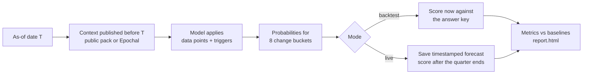
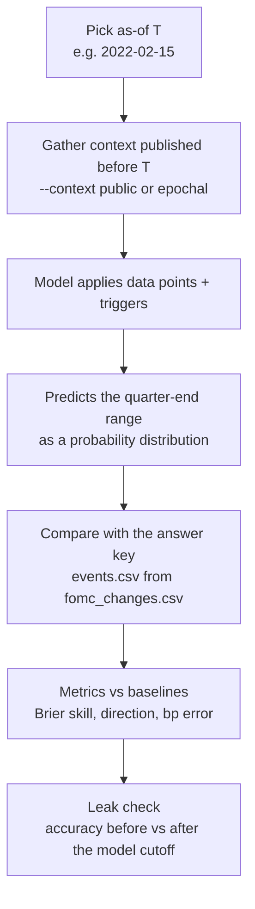
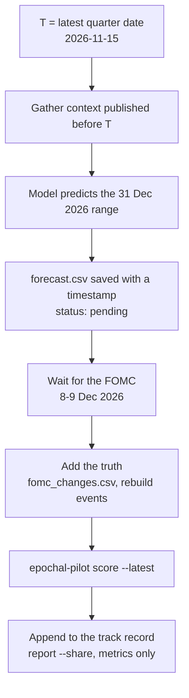

# epochal-pilot

[](https://github.com/sgarrepalli27/epochal-pilot/actions/workflows/ci.yml)
[](LICENSE)


**Forecast the Fed's next move from public data, keep a scored track record, and backtest the method
on ten years of history without leaking the answer.**

`epochal-pilot` is an evaluation harness for LLM forecasters, not an API wrapper. Its flagship scenario,
[`fed-quarterly`](scenarios/fed-quarterly), forecasts the FOMC target range at the next quarter-end.
The first live forecast is for **31 Dec 2026** (covering the 8–9 Dec 2026 FOMC). Each quarter adds one
scored, metrics-only result to a public track record. The same rules and data points can be
stress-tested on 2016–2026 as of any past date, with the web frozen at that date by the
[Epochal Time Portal](https://epochal.com), or with a shipped public-domain data pack that needs no requests.

## Two modes

| Mode | Command | What it tests | Strength | Limit |
|---|---|---|---|---|
| **Forecast (live)** | `run fed-quarterly --mode live` | Next quarter-end, forecast before it happens; `score` grades it afterwards | No leakage possible: the real proof | One result per quarter |
| **Backtest** | `run fed-quarterly` | Your rules and data points on past regime changes: 43 as-of dates 2016–2026, 10 tagged turning points | Fast, many points, wide range of regimes | The model may remember outcomes (see below) |

Publish each scored quarter with `epochal-pilot report <run> --share`: metrics only, no Epochal content.

### Epochal freezes the web, not the model

The as-of context can't contain the answer, but a model trained after the event may already know it.
So, for backtests, prefer a model whose training cutoff is **before** the events (for example a local
Ollama model with a 2023 cutoff). Run a recent model such as Claude too: its score is an upper bound on
memory. The report splits accuracy at each model's cutoff (`--cutoff MODEL=YYYY-MM`), and
`--modes gated,ungated` compares answers with and without context. Accuracy that holds after the cutoff
is skill; accuracy that collapses is memory. Live forecasts sidestep the problem entirely.

### How fed-quarterly works

| | |
|---|---|
| As-of dates T | Feb 15, May 15, Aug 15, Nov 15 each year |
| Forecast target | Target range at the following quarter-end: Mar 31, Jun 30, Sep 30, Dec 31 (about 6 weeks ahead) |
| Answer | Net change from T in 8 buckets (`Cut 100+ bp` … `No change` … `Hike 75+ bp`) with a probability for each |
| Scored by | Accuracy, Brier and Brier skill vs the best non-hindsight baseline, log loss, calibration, direction (down/hold/up) accuracy, error in bp, bootstrap CIs |

| Data points the model weighs | Triggers (rules of thumb in the prompt) |
|---|---|
| Inflation: core PCE, CPI and core CPI | Core inflation well above 2% with low unemployment: lean hike |
| Labor: unemployment rate, payrolls | Rising unemployment, weak growth or a shock: lean cut (shocks can bring unscheduled moves) |
| Fed signals: statement wording, dot plot, minutes | A shift in statement language ("patient", "further firming") usually precedes a turn |
| Markets: 2-year Treasury yield, curve (10y-2y, 10y-3m) | A 2-year yield well above/below the range: markets expect hikes/cuts |
| Growth: GDP, surveys, consumer spending | No scheduled meeting before quarter-end: only an emergency move can change the range |
| Shocks: financial stress, bank failures, pandemics | The Fed rarely surprises: it usually signals a move a meeting ahead |

### Budget

| Context | Source | Epochal requests |
|---|---|---|
| `--context public` | 307 public-domain Fed, BLS, BEA and Treasury documents, first-release only, each released before T | **0** |
| `--context epochal --only turning-point` | 1 web search as of each of the 10 turning-point dates | **exactly 10** (cached after) |
| `--mode live --context epochal` | 1 search for the live quarter | 1 |

### Quickstart (Windows PowerShell)

```powershell
git clone https://github.com/sgarrepalli27/epochal-pilot.git; cd epochal-pilot
py -m venv .venv; .\.venv\Scripts\Activate.ps1; pip install -e .
epochal-pilot validate fed-quarterly                                       # 0 requests: leak check of the public pack
# Forecast: the next quarter-end (31 Dec 2026), 0 requests
epochal-pilot run fed-quarterly --mode live --context public --backend claude-cli
# Backtest: 43 quarters on public first-release data, 0 requests
epochal-pilot run fed-quarterly --context public --backend ollama --model qwen2.5:3b
epochal-pilot report --latest                                              # HTML + markdown report of the newest run
# Turning points with the as-of web: exactly 10 requests (EPOCHAL_API_KEY in .env)
epochal-pilot run fed-quarterly --only turning-point --estimate
epochal-pilot run fed-quarterly --only turning-point --budget 10
# After 31 Dec 2026: add any change to fomc_changes.csv, rebuild, score the live forecast
python tools\build_fed_quarterly.py events
epochal-pilot score --latest
```

No keys at all? `epochal-pilot run fed-quarterly --dry-run --context public` runs the whole pipeline
with a mock model. macOS/Linux: same commands with `source .venv/bin/activate` and forward slashes.

## How it flows

Both modes share one pipeline; only the as-of date and the moment of scoring differ.



### Backtest



<details><summary><b>1. Pick the as-of dates</b>: all 43, one, or the 10 turning points</summary>

```powershell
epochal-pilot run fed-quarterly --only fq_2022q1 --context public --backend claude-cli
epochal-pilot run fed-quarterly --only turning-point --estimate     # Epochal cost: exactly 10
```
</details>

<details><summary><b>2. Gather context</b>: only documents released before T</summary>

```powershell
epochal-pilot validate fed-quarterly
```
```text
public context: 307 docs, 678,854 chars, ...; leak check: every doc predates its as-of date
OK: 0 error(s), 0 warning(s)
```
</details>

<details><summary><b>3-4. Model predicts</b>: one probability per bucket</summary>

Each prediction is a row in `predictions.csv` with `answer`, `probabilities` (all 8 buckets),
`p_outcome`, `brier`, `n_docs` and a one-line `rationale`.
</details>

<details><summary><b>5-6. Score and compare</b>: answer key, baselines, direction</summary>

```powershell
epochal-pilot report --latest
```
Writes `report.html` and `summary.md`: accuracy and Brier with 95% CIs, Brier skill against the best
non-hindsight baseline (`no-change`, `persistence`, `uniform`), calibration, and direction accuracy
with mean error in bp.
</details>

<details><summary><b>7. Leak check</b>: forecasting or remembering?</summary>

```powershell
epochal-pilot run fed-quarterly --context public --backend ollama --model qwen2.5:3b --modes gated,ungated
```
The `pre/post cutoff` columns split accuracy at the model's training cutoff; the ungated rows show
what the model answers with no context at all.
</details>

### Forecast (live)



<details><summary><b>1-3. Forecast now</b></summary>

```powershell
epochal-pilot run fed-quarterly --mode live --context public --backend claude-cli
```
</details>

<details><summary><b>4. Saved forecast</b>: <code>runs\fed-quarterly-live-public-&lt;time&gt;\forecast.csv</code></summary>

Columns: `status, forecast_created, model, mode, context, event, event_date, as_of, answer,
probabilities, ...`, with `status = pending` and the outcome blank. `summary.md` shows the forecast.
</details>

<details><summary><b>5-7. After the meeting: add the truth and score</b></summary>

```powershell
# Only if the Fed changed the range on 9 Dec 2026: add that row to scenarios\fed-quarterly\fomc_changes.csv
python tools\build_fed_quarterly.py events
epochal-pilot score --latest
epochal-pilot report --latest --share
```
`score` marks the forecast `resolved`, writes `predictions.csv`, `scores.csv` and `report.html` in
the same folder, and `--share` writes a metrics-only copy you can publish.
</details>

## Worked examples

### Backtest: as-of 15 Feb 2022, target 31 Mar 2022

The truth: **Hike 25 bp**, from 0.00-0.25% to 0.25-0.50% at the 16 Mar 2022 FOMC, the first hike after
two years at zero (a `turning-point`). The one scheduled meeting before quarter-end is 16 March.

What the model sees with `--context public` (real values from the shipped pack, each released before T):

| Document (released) | Key line |
|---|---|
| FOMC statement (26 Jan 2022) | "With inflation well above 2 percent and a strong labor market, the Committee expects it will soon be appropriate to raise the target range" |
| SEP / dot plot (15 Dec 2021) | Median federal funds rate: 0.9% at end-2022, 1.6% end-2023, 2.1% end-2024 |
| BLS CPI (10 Feb 2022) | CPI +7.5% over 12 months; core +6.0%, the largest since 1982 |
| BLS jobs (4 Feb 2022) | Payrolls +467,000 in January; unemployment 4.0% |
| BEA PCE (28 Jan 2022) | Core PCE +4.9% from a year ago (December) |
| Treasury yields (14 Feb 2022) | 2-year 1.58%, up from 0.53% three months earlier; 10y-2y spread +0.40 |
| FOMC minutes (released 5 Jan 2022) | Policy discussion and staff review from the December meeting |

Every trigger in the prompt points to a hike: core inflation far above 2%, low unemployment, the
statement's "soon be appropriate", and a 2-year yield well above the 0-0.25% range.

```powershell
epochal-pilot run fed-quarterly --only fq_2022q1 --context public --backend ollama --model qwen2.5:3b
```

Output folder: `predictions.csv`, `baseline_predictions.csv`, `scores.csv`, `stats.json`, `run.json`,
`summary.md`, `report.html`. The baselines on this point are fixed: `no-change` and `persistence` both
say No change (Brier 2.00, direction wrong) and `uniform` scores 0.875, so a model that puts most of its
probability on Hike 25 bp beats all three. One point is a demonstration, not evidence; run all 10 turning
points or all 43 quarters for statistics.

### Forecast: as-of 15 Nov 2026, target 31 Dec 2026

The range is **3.75-4.00%** after the 16 Sep 2026 hike and a hold on 28 Oct. The one scheduled meeting
before quarter-end is **8-9 Dec 2026**. What the model sees (real values from the pack):

| Document (released) | Key line |
|---|---|
| FOMC statement (28 Oct 2026) | Range maintained at 3-3/4 to 4 percent; two dissents (Cook, Hammack) preferred a 1/4 point hike |
| SEP / dot plot (16 Sep 2026) | Median federal funds rate 4.1% at end-2026, 4.1% end-2027, 3.9% end-2028 |
| BLS CPI (10 Nov 2026) | CPI +0.4% in October after +0.6% in September |
| BLS jobs (6 Nov 2026) | Payrolls +165,000 in October; unemployment 4.1% |
| BEA PCE (29 Oct 2026) | PCE +3.6%, core +3.1% from a year ago (September) |
| Treasury yields (13 Nov 2026) | 3-month 4.32%, 2-year 4.88%, 10-year 5.15% |

```powershell
epochal-pilot run fed-quarterly --mode live --context public --backend claude-cli
```

This writes `runs\fed-quarterly-live-public-<time>\forecast.csv` and a `summary.md` like the one
below (**illustrative**: the format is real, the answer and probability are placeholders):

```text
| event     | as-of      | resolves after | model   | answer     | p    |
| fq_2026q4 | 2026-11-15 | 2026-12-31     | default | Hike 25 bp | 0.55 |
```

In January 2027: add the 9 Dec decision to `fomc_changes.csv` if the range changed (nothing to add on a
hold), run `python tools\build_fed_quarterly.py events`, then `epochal-pilot score --latest`. The
forecast is graded with the same metrics as the backtest and becomes the first point of the track record.

## What else is in the box

- **Honest statistics.** Bootstrap 95% intervals, Brier skill vs the best non-hindsight baseline,
  log loss, calibration (reliability) tables, paired bootstrap and McNemar tests, small-sample warnings.
- **Two context sources.** The time-gated web (Epochal), or shipped public-domain packs
  (`--context public`, 0 requests). Compare them on the same events.
- **Leak checks.** Results dated after the as-of moment are dropped; scores split by each model's
  training cutoff; question wording checked for answer leaks.
- **Reports.** Self-contained HTML (inline SVG, no JavaScript) and markdown, a cross-run leaderboard,
  and a metrics-only `--share` export that is safe to publish.
- **Request planner.** `plan --requests N` picks the events that carry the most signal per request.
- **More scenarios.** `fed-rates` (23 FOMC decisions, 2024–2026) and `future-leak` (20 resolved events).
- **Zero dependencies.** Python 3.10+ standard library only. Windows, macOS, Linux (x64 and ARM64).

## What you need and why

| You need | Why | Cost |
|---|---|---|
| **A model** (the forecaster under test) | It reads the as-of context and gives probabilities for each option. That is what gets scored. | Free (local) to cents |
| **Epochal key** (optional at first) | The web frozen before the event, so the model can't read the outcome. | 100 free requests |
| **Nothing else** | Public-context mode, reports, stats, planning and validation are offline. | 0 |

Pick the model by the question you're asking:

| Question | Use | Why |
|---|---|---|
| Can a model **forecast** from evidence? | A model whose training cutoff is **before** the events (local Ollama, `gpt-4.1-mini`) | It can't have memorised outcomes |
| Does a model **already know** the outcome (leak)? | A model trained **after** the events (Claude via `claude-cli` or `anthropic`) | Compare with the gated score and with old-cutoff models |
| Best signal | **Both**, on the same events | Old-cutoff vs new-cutoff on the same evidence separates skill from memory |

Setup per option, plus the 0-request path, is in **[docs/what-you-need.md](docs/what-you-need.md)**.
`epilot` is a short alias for `epochal-pilot`; `python -m epochal_pilot` works too.
Full Windows setup is in [Replicate on Windows](#replicate-on-windows).

## Your 100 requests

Epochal's free tier is 100 search/fetch requests per account. Spend them last, and only where they add signal.

| Step | Command | Epochal requests |
|---|---|---|
| 1. Check setup | `epochal-pilot check` | 0 |
| 2. Validate scenarios | `epochal-pilot validate fed-rates` | 0 |
| 3. Try everything offline | `epochal-pilot run fed-rates --dry-run` | 0 |
| 4. Real model, public context | `epochal-pilot run fed-rates --context public --backend ollama --model qwen2.5:3b` | 0 |
| 5. Plan | `epochal-pilot plan fed-rates --requests 25 --model qwen2.5:3b --model openai/gpt-4.1-mini` | 0 |
| 6. Estimate | `epochal-pilot run fed-rates --estimate` | 0 |
| 7. Full fed-rates run, several models | `epochal-pilot run fed-rates --model openai/gpt-4.1-mini --model google/gemini-2.5-flash --budget 30` | ~23-30 |
| 8. Full future-leak run | `epochal-pilot run future-leak --budget 25` | ~20-25 |
| 8b. fed-quarterly turning points | `epochal-pilot run fed-quarterly --only turning-point --budget 10` | 10 |
| 8c. fed-quarterly live forecast (Dec 2026) | `epochal-pilot run fed-quarterly --mode live --budget 1` | 1 |
| 9. Compare and report | `epochal-pilot compare runs/a runs/b` and `report <run> --share` | 0 |

That is a full, high-signal run for about **50 requests**, leaving about 50 for your own scenario
(`epochal-pilot new my-scenario`). Responses are cached, so rerunning with more models, prompts or
seeds costs nothing. Searches return 10 results for the price of one; only 2xx responses are counted
(failed requests are refunded locally, as Epochal doesn't bill them).

## Epochal terms: what you may share

Read the [Time Portal Product Terms](https://epochal.com/legal/time-portal-product-terms). In short:

- **Don't publish Results**: no cached responses, URLs, titles, snippets or page text from Epochal,
  and no evaluation datasets built from them (§3.3, §3.4). The cache (`.epochal-pilot-cache/`) and
  `runs/` are gitignored for this reason. Don't commit them or hand them to others.
- **Share metrics only.** `epochal-pilot report <run> --share` writes `share/` with scores, event
  ids, outcomes and the options models chose: no Epochal content, request ids or model rationales.
- **US only.** Epochal currently refuses requests from outside the United States.
- **Each person uses their own key.** A clone pays for its own requests; there is no shared cache.

The public-domain context pack is different: it's US-government work, shipped in this repo, and free to reuse.

## Commands

| Command | What it does | Requests |
|---|---|---|
| `list`, `check` | Scenarios; which keys are set (never values); whether `claude` is on PATH | 0 |
| `run <scenario>` | Run models on events; writes predictions, scores, stats, report | 0 with `--context public` or `--dry-run` |
| `run ... --estimate` | Exact new searches; fetches exact when a search is cached, else a range | 0 |
| `plan <scenario> --requests N` | Picks events and lead times for most signal per request; prints the `run` command | 0 |
| `run ... --mode live` | Forecast events whose outcome isn't known yet; writes a timestamped `forecast.csv` | 0 with `--context public` |
| `run/plan ... --only <ids or tags>` | Select events by id or tag, e.g. `--only turning-point` | — |
| `score <run_dir>` / `score --latest` | Resolve and score a live forecast once its outcome is in the scenario | 0 |
| `report <run_dir> [--share]` / `report --latest` | HTML + markdown report (`--latest`: newest folder in `runs/`); `--share` adds a metrics-only folder | 0 |
| `compare <run_dir>...` | Leaderboard plus paired tests on shared events (e.g. public vs Epochal context) | 0 |
| `validate <scenario>` | Schema, dates vs model cutoffs, source URLs, wording, public-pack leak check | 0 |
| `new <name>` | Scaffold a scenario folder | 0 |

### Backends

| `--backend` | Needs | Default model | Notes |
|---|---|---|---|
| `openrouter` (default) | `OPENROUTER_API_KEY` | `openai/gpt-4.1-mini` | Hundreds of models; cents per run |
| `anthropic` | `ANTHROPIC_API_KEY` | `claude-haiku-5-5` | Claude API |
| `claude-cli` | [Claude Code](https://code.claude.com) installed and logged in | your Claude Code default | No key; uses your Claude subscription; **all tools disabled** |
| `ollama` | [Ollama](https://ollama.com) running | `llama3.2:3b` | Local, free, private |

**`claude-cli`.** Runs `claude -p --output-format json --max-turns 1 --no-session-persistence
--strict-mcp-config --disallowedTools "*"` with the prompt on stdin, from an empty temporary folder.
Every tool (WebSearch, WebFetch, Bash, file reads) and every MCP server is removed, so the model
can't look up the outcome: its answer must come from the prompt. Use `--model sonnet` (or any Claude
Code model name) to choose a model. Claude's training cutoff is after most shipped events, so this is a
**leak probe**, not a fair forecast test; pass `--cutoff default=YYYY-MM` (or `--cutoff sonnet=...`)
for the right pre/post split. `CLAUDE_CLI_TIMEOUT` (seconds, default 300) sets the timeout.

## Replicate on Windows

Works on Windows 11, x64 or ARM64 (e.g. Surface Pro with Snapdragon X), in PowerShell with Python 3.10+.
CI runs the test suite on `windows-latest` and `windows-11-arm`.

**1. Install Python and Git** (skip what you already have)

```powershell
winget install --id Python.Python.3.12 -e
winget install --id Git.Git -e
# Close and reopen PowerShell, then check:
py --version
git --version
```

Or use the installers from [python.org](https://www.python.org/downloads/windows/) (pick the ARM64
installer on Snapdragon devices) and [git-scm.com](https://git-scm.com/download/win).

**2. Clone and create a virtual environment**

```powershell
cd $HOME
git clone https://github.com/sgarrepalli27/epochal-pilot.git
cd epochal-pilot
py -m venv .venv
.\.venv\Scripts\Activate.ps1
```

If PowerShell says running scripts is disabled, allow it for your user once, then activate again:

```powershell
Set-ExecutionPolicy -Scope CurrentUser -ExecutionPolicy RemoteSigned
.\.venv\Scripts\Activate.ps1
```

**3. Install**

```powershell
python -m pip install --upgrade pip
pip install -e .
```

**4. Zero-request steps first**

```powershell
epochal-pilot check
epochal-pilot validate fed-rates
epochal-pilot run fed-rates --dry-run --context public --out runs\pub-dry
epochal-pilot report runs\pub-dry
start runs\pub-dry\report.html
```

**5. Add keys (only the ones you need)**

```powershell
copy .env.example .env
notepad .env
```

`EPOCHAL_API_KEY` for the frozen web; `OPENROUTER_API_KEY` or `ANTHROPIC_API_KEY` for cloud models;
nothing for `ollama` or `claude-cli`. `.env` is gitignored; never commit it.

**6. Local or Claude Code models, still 0 Epochal requests**

```powershell
# Ollama: install from https://ollama.com/download, then
ollama pull qwen2.5:3b
epochal-pilot run fed-rates --context public --backend ollama --model qwen2.5:3b

# Claude Code: install from https://code.claude.com, run `claude` once to log in, then
epochal-pilot run fed-rates --context public --backend claude-cli --cutoff default=2026-06
```

Small 1-3B models suit a 16 GB laptop; close other apps if memory is tight, and set
`OLLAMA_NUM_CTX=8192` in `.env` if Ollama runs out of memory.

**7. Spend Epochal requests**

```powershell
epochal-pilot plan fed-rates --requests 25 --model openai/gpt-4.1-mini
epochal-pilot run fed-rates --estimate
epochal-pilot run fed-rates --model openai/gpt-4.1-mini --model google/gemini-2.5-flash --budget 30 --out runs\fed-epochal
epochal-pilot run fed-rates --context public --model openai/gpt-4.1-mini --model google/gemini-2.5-flash --out runs\fed-public
epochal-pilot compare runs\fed-public runs\fed-epochal --out runs\compare
```

**8. fed-quarterly: 10-year backtest, turning points, and a live forecast**

```powershell
# 43 quarters from public first-release data: 0 Epochal requests
epochal-pilot run fed-quarterly --context public --backend claude-cli --cutoff default=2026-06 --out runs\fq-public
epochal-pilot report --latest
# 10 turning points with the as-of web: exactly 10 requests (check first with --estimate)
epochal-pilot plan fed-quarterly --requests 10 --only turning-point
epochal-pilot run fed-quarterly --only turning-point --estimate
epochal-pilot run fed-quarterly --only turning-point --backend claude-cli --budget 10 --out runs\fq-epochal-tp
epochal-pilot run fed-quarterly --only turning-point --context public --backend claude-cli --out runs\fq-public-tp
epochal-pilot compare runs\fq-public-tp runs\fq-epochal-tp --out runs\fq-compare
# Live: forecast 31 Dec 2026 now (0 requests with public context), score it in January
epochal-pilot run fed-quarterly --mode live --context public --backend claude-cli
epochal-pilot score --latest
```

### macOS and Linux

The same steps with `python3 -m venv .venv && source .venv/bin/activate`, `cp .env.example .env`,
and forward slashes in paths.

## Outputs

Each run writes `runs/<scenario>-<context>-<time>/` (choose with `--out`):

| File | Contents | Shareable |
|---|---|---|
| `report.html`, `summary.md` | Scores with CIs, paired tests, reliability chart, per-event table, cost ledger | Metrics only, but regenerate with `--share` to be safe |
| `scores.csv` | One row per forecaster, with CIs, skill, calibration, pre/post-cutoff split | Yes |
| `stats.json` | Calibration bins, reference baseline, paired tests | Yes |
| `predictions.csv` | Per event: answer, probabilities, **cited URLs, rationale** | **No** (Epochal content) |
| `baseline_predictions.csv` | Baseline probabilities per event | Yes |
| `run.json` | Manifest: git SHA, version, events/prompt hashes, model + params, seed, search settings, Epochal ledger with request/copy ids | Local; `share/run.json` drops ids |
| `share/` | Written by `report --share`: metrics-only copies | Yes |

## Interpreting results

- **Look at intervals first.** With 23 events, one event moves accuracy by about 4 points. Overlapping
  intervals mean "can't tell".
- **Skill, not accuracy.** `brier_skill` (BSS) compares with the best *non-hindsight* baseline on the
  same events (`no-change`, `persistence`, `uniform`, or your own `--baseline-csv`). BSS > 0 with an
  interval above 0 is real skill. `majority(hindsight)` uses the outcomes being scored: context only.
- **Paired tests for differences.** `p vs ref`, and the gated-vs-ungated and run-vs-run tables, test
  differences on the same events (bootstrap of Brier differences, exact McNemar on right/wrong).
- **Calibration.** In the reliability chart, points on the diagonal are well calibrated; below it is
  overconfident. ECE summarises the gap.
- **Leakage.** High accuracy *before* the cutoff with a drop *after* it, or ungated accuracy close to
  gated accuracy, points to memorised outcomes. Accuracy that holds up after the cutoff is skill.
- **Public vs Epochal context.** `compare` on the same events shows what the time-gated web adds over
  official documents alone.

| Column | Meaning |
|---|---|
| `accuracy` [`_ci_low`, `_ci_high`] | Share of events where the top answer was right; 95% bootstrap CI |
| `brier` | Multi-class Brier, Σ(p − outcome)²: 0 perfect, 2 confidently wrong; uniform over k options = 1 − 1/k |
| `log_loss` | −ln p(outcome), floored at 1e-6 (a confident miss costs ~13.8) |
| `brier_skill`, `reference` | 1 − Brier / reference Brier, vs the best non-hindsight baseline |
| `p_vs_reference` | Paired bootstrap p-value, model vs reference Brier |
| `ece` | Expected calibration error over 5 confidence bins |
| `acc_pre_cutoff` / `acc_post_cutoff` | Split at the model's training cutoff ([models.json](src/epochal_pilot/models.json); `--cutoff MODEL=YYYY-MM`) |
| `leak_score_upper_bound` | Gated accuracy minus chance (an upper bound, not proof) |
| `always_fav_letter_acc` | Accuracy of always picking the favourite option letter (position bias) |
| `small_n` | 1 when n < 30 |

## Scenarios

| Scenario | Events | Question | Context packs |
|---|---|---|---|
| [`fed-rates`](scenarios/fed-rates) | 23 FOMC meetings, Jan 2024 – Oct 2026 (10 from Sep 2025, incl. the Sep 2026 hike) | Hold / cut 25 / cut 50 / cut 75 / hike 25 | Epochal, public |
| [`fed-quarterly`](scenarios/fed-quarterly) | 43 quarter-ends 2016 Q1 – 2026 Q3 + 1 live (2026 Q4), each forecast from Feb/May/Aug/Nov 15 | Net change in the target range by quarter-end: cut 100+ … hike 75+ | Public first-release (0 requests), Epochal (1 per T) |
| [`future-leak`](scenarios/future-leak) | 20 resolved 2024–25 events (elections, Fed, launches, earnings) | Does the model already know the outcome? | Epochal (+ ungated) |

Every outcome links to its public source. The `fed-rates` public pack holds 114 trimmed documents
(FOMC statements and minutes, BLS CPI and jobs releases), each dated by public release; a document is
used only if released strictly before the as-of date ([details](scenarios/fed-rates/README.md)).

**`fed-quarterly`** walks forward through ten years of Fed policy. At each as-of date T the model gets
the latest FOMC statement, minutes, dot plot, CPI, jobs, PCE and Treasury-curve data released before T
(first-release numbers, no later revisions), a list of the data points and triggers rates desks weigh,
and the scheduled meetings before quarter-end. It is scored on the bucket, on direction (down / hold /
up) and on error in bp. Spend Epochal requests only on the 10 `turning-point` dates (`--only
turning-point`, 1 request each), and run `--mode live` for the Dec 2026 quarter
([details and budget guide](scenarios/fed-quarterly/README.md)).

**Market baseline.** Not shipped: Kalshi's and Polymarket's terms don't allow redistributing their
price histories. If you have data you're allowed to use, pass it with `--baseline-csv my.csv`
(columns `name,event,<one column per option>`); it becomes a non-hindsight skill reference.

## How it works

```
event (date, question, options)
   │  as_of = event_date − lead_days
   ▼
context: Epochal search/fetch (Accept-Datetime: as_of)  or  public pack (docs released < as_of)
   │  drop anything dated after as_of (search published_at, then the fetched copy's published_at)
   ▼
prompt: "Today is <as_of>. Use only this context." + shuffled options
   ▼
model ──► {"answer": "C", "probabilities": {...}, "citations": [...], "rationale": "..."}
   │  no option picked → one forced-choice retry → else abstain (scored wrong, uniform probs)
   ▼
score: accuracy, Brier, log loss + CIs, skill vs baselines, calibration, paired tests, cutoff split
```

### Budget and retrieval

| Setting | Default | Where |
|---|---|---|
| `num_results` | 10 (API max, same cost as 1) | `scenario.json`, `--num-results` |
| `published_after_days` | 30 (search window before as-of); `null` for none | `scenario.json` |
| `categories` | all (`news`, `finance` = SEC filings, ...) | `scenario.json` |
| `domains` / `exclude_domains` | none | `scenario.json` |
| `max_fetches` | 2 per event, only for results with little text | `scenario.json`, `--max-fetches` |
| `--budget N` | 10 new requests per run | CLI |
| `--max-total N` | 90 lifetime for this cache | CLI, `EPOCHAL_PILOT_MAX_TOTAL` |

## Add a scenario

```bash
epochal-pilot new my-scenario          # scaffold
# edit scenarios/my-scenario/events.csv (future-tense questions, source_url per event)
epochal-pilot validate my-scenario
epochal-pilot run my-scenario --dry-run
```

See [docs/adding-a-scenario.md](docs/adding-a-scenario.md).

## Caveats

- **Small samples.** Tens of events give wide intervals. The tool says so; believe it.
- **Stated cutoffs are claims.** Vendors' training cutoffs can be vague or understated.
- **Newer models saw the outcomes.** Use them to measure leakage, not forecasting skill.
- **A week out, markets usually know.** Fed decisions are mostly priced in; try `--lead-days 28`.
- **The archive is not the whole web.** Epochal coverage varies; undated results are kept and counted.
- **Not investment advice.** This is a research benchmark.

## Security

Keys are read from the environment or `.env` (gitignored) and are never printed, logged or written
to outputs. See [SECURITY.md](SECURITY.md).

## Contributing

Issues and pull requests are welcome, especially new scenarios. See [CONTRIBUTING.md](CONTRIBUTING.md).

## License

[Apache-2.0](LICENSE). The public context pack is US-government work in the public domain
([Federal Reserve Board](https://www.federalreserve.gov/disclaimer.htm),
[BLS](https://www.bls.gov/opub/copyright-information.htm)). Not affiliated with Epochal, OpenRouter,
Anthropic, Ollama, the Federal Reserve or BLS.
