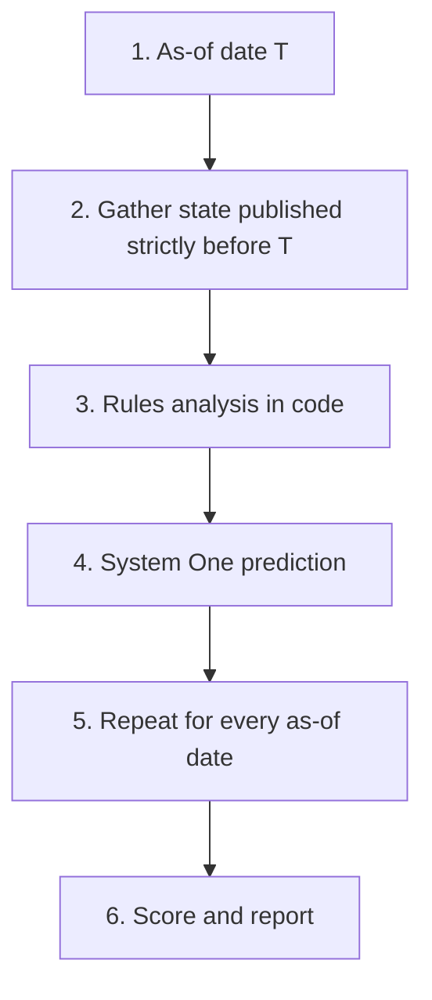
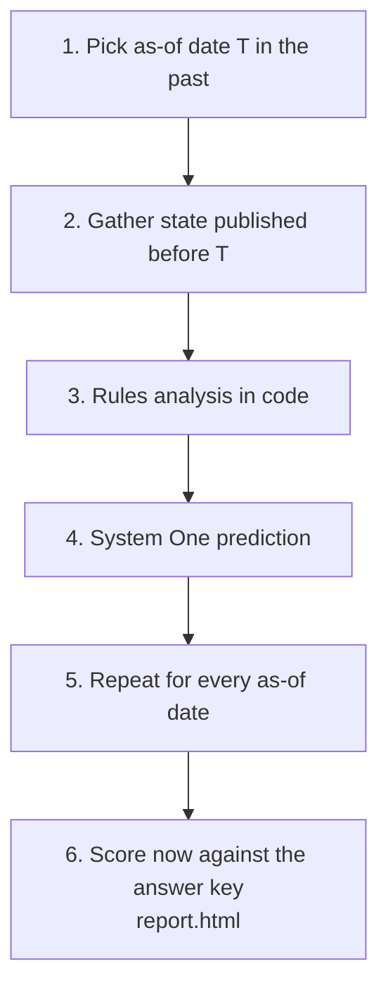
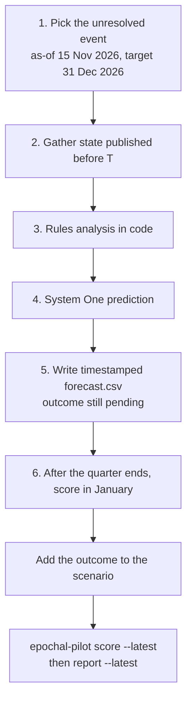
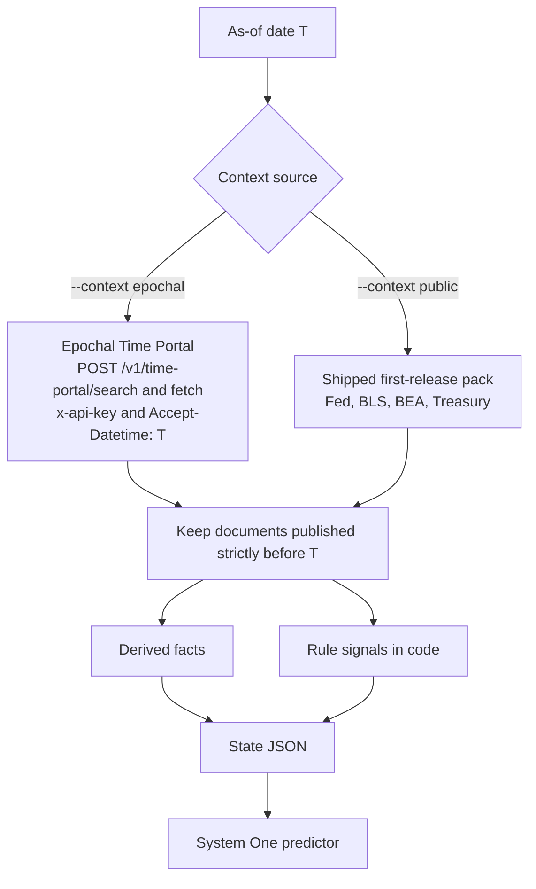

# epochal-pilot

[](https://github.com/sgarrepalli27/epochal-pilot/actions/workflows/ci.yml)
[](LICENSE)


**Backtest and forecast agents as of any date, with leak-aware context so the future cannot sneak into the prompt.**

`epochal-pilot` is an evaluation harness, not an API wrapper. Pick a System One predictor, supply your
own key, and run the same pipeline on history (backtest) or on events that have not resolved yet
(live forecast). The flagship scenario, [`fed-quarterly`](scenarios/fed-quarterly), forecasts the
FOMC target range at quarter-end from each as-of date T.

## Get started

Python 3.10+. Clone, create a venv, install, and copy [`.env.example`](.env.example) to `.env`.
`.env` is gitignored. `epochal-pilot check` shows which keys are set, never their values.

`EPOCHAL_API_KEY` is optional (needed only for `--context epochal`). For predictions, set **one**
System One key — `TYPESAFE_API_KEY`, `OPENAI_API_KEY`, or `GEMINI_API_KEY` (`GOOGLE_API_KEY` is
accepted as a Gemini fallback). System Two keys (`OPENROUTER_API_KEY`, `ANTHROPIC_API_KEY`) are
optional and used for `--analyst` rationales. No key is required for `--backend rules`,
`--backend ollama`, or `--backend claude-cli`.

The first run below uses the shipped public first-release pack (**0 Epochal requests**). The default
predictor is `jev-rules` when `TYPESAFE_API_KEY` is set, otherwise `rules`. Pass `--backend` to pick
another provider.

### Windows (PowerShell)

```powershell
git clone https://github.com/sgarrepalli27/epochal-pilot.git
cd epochal-pilot
py -m venv .venv
.\.venv\Scripts\Activate.ps1
pip install -e .
Copy-Item .env.example .env
# Edit .env and add one System One key (optional: EPOCHAL_API_KEY, System Two keys).
epochal-pilot check
epochal-pilot run fed-quarterly --context public --only fq_2022q1
epochal-pilot report --latest
```

### macOS / Linux

```bash
git clone https://github.com/sgarrepalli27/epochal-pilot.git
cd epochal-pilot
python3 -m venv .venv
source .venv/bin/activate
pip install -e .
cp .env.example .env
# Edit .env and add one System One key (optional: EPOCHAL_API_KEY, System Two keys).
epochal-pilot check
epochal-pilot run fed-quarterly --context public --only fq_2022q1
epochal-pilot report --latest
```

`--context public` is already the default for System One predictors; it is spelled out here so the
first run cannot spend Epochal requests. To try a provider explicitly:

```bash
epochal-pilot run fed-quarterly --context public --only fq_2022q1 --backend jev-rules
epochal-pilot run fed-quarterly --context public --only fq_2022q1 --backend openai-decisions
epochal-pilot run fed-quarterly --context public --only fq_2022q1 --backend gemini-decisions
epochal-pilot run fed-quarterly --context public --only fq_2022q1 --backend rules
```

No keys at all? `epochal-pilot run fed-quarterly --dry-run --context public --only fq_2022q1` walks
the pipeline with a mock predictor.

<details>
<summary>Illustrative <code>epochal-pilot check</code> output (values are never printed)</summary>

```
epochal-pilot 0.3.1
  EPOCHAL_API_KEY              missing
  TYPESAFE_API_KEY             set
  OPENAI_API_KEY               missing
  GEMINI_API_KEY               missing
  GOOGLE_API_KEY               missing
  OPENROUTER_API_KEY           missing
  ANTHROPIC_API_KEY            missing
  claude (Claude Code)         not found (needed only for --backend claude-cli)
  Epochal requests used (lifetime, this cache): 0 (free tier: 100 per account)
  scenarios: fed-quarterly, fed-rates, future-leak
```

</details>

## How it works

The official pipeline keeps analysis in code and uses a System One predictor only for the judgment.

1. Pick an as-of date T.
2. Gather state published strictly before T (public pack or a time-portal API).
3. Analyse that state against business rules **in code** (inflation gap, unemployment trend, SEP gap,
   statement tone, shocks).
4. Ask a System One predictor for a distribution over the options (`jev-rules` always includes the
   rule analysis; other System One backends do so with `--with-rules`).
5. Repeat for every as-of date.
6. Compare to ground truth and write the report (table, analysis, p(true) timeline, calibration).

`--backend jev` skips step 3 and omits rule analysis from the state. `--backend rules` stops after
step 3 and maps the same signals to a distribution with no model.



## Modes

| Mode | Command | When it scores | What it tests |
|---|---|---|---|
| **Backtest** (default) | `epochal-pilot run fed-quarterly --context public` | Immediately, against the answer key | 43 as-of dates (2016–2026) and, optionally, 10 `turning-point` dates |
| **Forecast (live)** | `epochal-pilot run fed-quarterly --mode live --context public` | After the quarter ends, in January, via `epochal-pilot score --latest` | The unresolved event (2026 Q4: as-of 15 Nov 2026, target 31 Dec 2026) |

Both modes share the six steps; only the as-of date and the moment of scoring change.

### Backtest



### Forecast (live)



For `fed-quarterly`, add any FOMC change to `scenarios/fed-quarterly/fomc_changes.csv`, rebuild events
with `python tools/build_fed_quarterly.py events`, then run `epochal-pilot score --latest`.

## Model choices

**System One** is the recommended predictor: a typed choice over the option set, with a probability
for every bucket. Developers pick one provider and supply their own key.

**System Two** models are for analysis. Use `--analyst {openrouter,anthropic,ollama,claude-cli}` to
attach a rationale *after* the forecast; it does not change probabilities. They remain valid
`--backend` values for compatibility, but they are not the recommended default predictor.

**Rules** (`--backend rules`) is a no-model baseline: the same in-code checklist, mapped to a
distribution. The checklist is honest about 2016–2026 hindsight.

TypeSafe Jev (`--backend jev` and `jev-rules`) has been tested live against the TypeSafe API.
`--backend openai-decisions` and `--backend gemini-decisions` have only been tested against
mocked or simulated responses and have not yet been run live. Prices below are as of 2026-11-26
and are linked to the official page that states them.

| Provider | `--backend` | Role | Key | Default model | Notes |
|---|---|---|---|---|---|
| TypeSafe Jev | `jev-rules` | System One (recommended default) | `TYPESAFE_API_KEY` | [`jev-latest`](https://docs.typesafe.ai/models) | Official pipeline: code analysis, then Choice. Default when the TypeSafe key is set. Input $0.042 / 1M tokens; output free (as of 2026-11-26; [TypeSafe models](https://docs.typesafe.ai/models)). TypeSafe documents that Jev is [trained to return calibrated decisions](https://docs.typesafe.ai/models). Tested live. |
| TypeSafe Jev | `jev` | System One | `TYPESAFE_API_KEY` | [`jev-latest`](https://docs.typesafe.ai/models) | Choice on as-of context only (no rule analysis unless `--with-rules`). Same model, price, and live testing as `jev-rules`. |
| OpenAI Decisions | `openai-decisions` | System One | `OPENAI_API_KEY` | [`gpt-6-luna`](https://developers.openai.com/api/docs/guides/decisions) | Official [Decisions API](https://developers.openai.com/api/docs/guides/decisions) (`POST /v1/decisions`). Uncached input $0.10 / 1M tokens; output not charged (as of 2026-11-26; [Decisions guide](https://developers.openai.com/api/docs/guides/decisions), [pricing](https://developers.openai.com/api/docs/pricing)). Official docs describe probability estimates and do not claim they are calibrated. Tested only against mocked/simulated responses, not yet run live. |
| Gemini Decisions | `gemini-decisions` | System One | `GEMINI_API_KEY` or `GOOGLE_API_KEY` | [`gemini-decision-1`](https://aistudio.google.com/docs/models/gemini-decision-1) | Official [Decisions API](https://aistudio.google.com/docs/decisions-api) (`x-goog-api-key`). Paid input $0.10 / 1M tokens; output not applicable (0 output tokens); free tier free of charge (as of 2026-11-26; [pricing](https://aistudio.google.com/docs/pricing), [model page](https://aistudio.google.com/docs/models/gemini-decision-1)). Official docs state that the API [returns calibrated probabilities](https://aistudio.google.com/docs/decisions-api). Tested only against mocked/simulated responses, not yet run live. |
| Rules checklist | `rules` | Baseline | — | `rules` | No model. Default when no TypeSafe key is set. |
| OpenAI (structured) | `openai` | System One fallback | `OPENAI_API_KEY` | `gpt-4o-mini` | Schema-locked LLM output, labeled “not calibration-trained”. `--structured-api responses` (default) or `chat`. |
| Gemini (structured) | `gemini` | System One fallback | `GEMINI_API_KEY` or `GOOGLE_API_KEY` | `gemini-2.0-flash` | Schema-locked `generateContent`. Same fallback label. |
| OpenRouter | `openrouter` | System Two | `OPENROUTER_API_KEY` | `openai/gpt-4.1-mini` | Prefer `--analyst openrouter` for a rationale only. |
| Anthropic | `anthropic` | System Two | `ANTHROPIC_API_KEY` | `claude-haiku-5-5` | Claude API. |
| Claude Code | `claude-cli` | System Two | Claude Code login (no API key) | your Claude Code default | Tools disabled so it cannot look up the answer. |
| Ollama | `ollama` | System Two | — (local daemon) | `llama3.2:3b` | Local, free. Useful as an old-cutoff leak probe when used as `--backend`. |

Pick a predictor with `--backend`. Add `--with-rules` to include the in-code checklist in any System
One state (`jev-rules` always does this). Add `--model` to override the default model id. To add a
third-party System One provider, see [docs/adding-a-provider.md](docs/adding-a-provider.md).

## Building state

Context is gathered as of T, then reduced to a JSON state for the predictor.

- **Public first-release pack** (`--context public`, default for System One): shipped US-government
  documents (Fed, BLS, BEA, Treasury), first-release only. Used only if released strictly before T.
  **0 Epochal requests.**
- **Epochal Time Portal** (`--context epochal`): date-gated web search and fetch.
  `POST https://api.epochal.com/v1/time-portal/{search,fetch}` with `x-api-key` and
  `Accept-Datetime: T`. Results published at or after T are dropped. Needs `EPOCHAL_API_KEY`.

Derived facts (for example the SEP gap and remaining FOMC meetings) and in-code rule signals are
then attached, producing the state JSON.



<details>
<summary>Illustrative state (not a live payload)</summary>

The shape matches `build_state` in `src/epochal_pilot/jev.py`. Numbers and text below are
**illustrative**, not copied from a live API response or a real run.

```json
{
  "as_of": "2022-02-15",
  "forecast_date": "2022-03-31",
  "policy_range": "0.00-0.25%",
  "question": "What will the net change in the FOMC target range be by quarter-end?",
  "scheduled_meetings_before_target": "16 March 2022",
  "derived_facts": "SEP median end-2022 0.9% vs current midpoint 0.125% = +77.5 bp (illustrative).",
  "documents": [
    {
      "title": "FOMC Statement",
      "published": "2022-01-26",
      "url": "https://www.federalreserve.gov/newsevents/pressreleases/example.htm",
      "text": "…"
    }
  ],
  "rule_analysis": {
    "inflation": {"core_pce_yoy_pct": 5.2, "gap_vs_2pct_goal_pp": 3.2, "measure_used": "core_pce"},
    "labour": {"unemployment_pct": 4.0, "unemployment_trend": "stable"},
    "shock_present": false,
    "rules_point_estimate": {"expected_bp": 25, "nearest_bucket": "Hike 25 bp"}
  },
  "business_rules": "Core inflation well above 2% with a tight labour market: lean hike. …"
}
```

Blind runs (`--no-context`) omit `documents`, `derived_facts`, `rule_analysis`, and `business_rules`.

</details>

### Adding another time-portal source

Epochal is the built-in time-portal client (`src/epochal_pilot/epochal.py`). To add another
date-gated source:

1. Implement a client that gates every request on T (Epochal uses the `Accept-Datetime` header).
2. Filter results so only documents published **strictly before T** are kept.
3. Return documents as `{title, published_at, url, text}` so they can enter `build_state`.
4. Wire a new `--context` value in the runner, or contribute a first-release pack under
   `public_context/` (see [docs/adding-a-scenario.md](docs/adding-a-scenario.md)).

Do not include API keys in URLs, errors, logs, or cache keys.

## Leak checks

The as-of context cannot contain the answer, but a model trained after the event may already know it.
Live forecasts sidestep that problem. For backtests:

| Check | Flag | What it does |
|---|---|---|
| Blind | `--no-context` | Same question with the as-of date and current policy range only. No documents, derived facts, or rule analysis. 0 Epochal requests. Overrides `--context`. |
| Date masking | `--mask-dates` | Keeps the documents but rewrites calendar years relative to T (`Year 0`, `Year -1`, …). |
| Pre/post cutoff | report split; `--cutoff MODEL=YYYY-MM` | Accuracy is split at the model's training cutoff ([models.json](src/epochal_pilot/models.json)). Accuracy that holds after the cutoff is skill; a collapse suggests memory. |
| Gated vs ungated | `--modes gated,ungated` | Compare answers with as-of context vs memory only. |

## Budget

Epochal accounts include **100 free requests**. Only 2xx responses count; failed requests are
refunded locally. Responses are cached, so reruns with more models or seeds do not spend again.
`--budget` defaults to 10 new requests this run; `--max-total` defaults to 90 for this cache
(leave a margin under the free-tier cap). Run `--estimate` before you spend.

| Context | Epochal requests |
|---|---|
| `--context public` or `--no-context` or `--dry-run` | **0** |
| `--context epochal --only turning-point` | **exactly 10** (one search per turning-point date; cached after) |
| `--mode live --context epochal` | 1 |
| `plan <scenario> --requests N` | 0 (prints a `run` command that fits N) |

System One backends default to `--context public`, so a forgotten flag cannot spend Epochal requests.

## Scenarios

| Scenario | Events | Question | Context |
|---|---|---|---|
| [`fed-quarterly`](scenarios/fed-quarterly) | 43 quarter-ends (2016 Q1–2026 Q3) + 1 live (2026 Q4) | Net change in the FOMC target range by quarter-end (8 buckets) | Public first-release (0 requests) or Epochal (1 per T) |
| [`fed-rates`](scenarios/fed-rates) | 23 FOMC meetings, Jan 2024–Oct 2026 | Hold / cut / hike at that meeting | Public pack or Epochal |
| [`future-leak`](scenarios/future-leak) | 20 resolved 2024–25 events | Does the model already know the outcome? | Epochal, gated + ungated |

Every outcome links to a public source. Optional market baselines you are allowed to use can be
passed with `--baseline-csv` (columns `name,event,<one column per option>`).

### Adding a scenario

```bash
epochal-pilot new my-scenario
# Edit scenarios/my-scenario/events.csv (future-tense questions, a public source_url per event).
epochal-pilot validate my-scenario
epochal-pilot run my-scenario --dry-run
```

See [docs/adding-a-scenario.md](docs/adding-a-scenario.md).

<details>
<summary>Command reference</summary>

| Command | What it does | Epochal requests |
|---|---|---|
| `list`, `check` | Scenarios; which keys are set (never values); whether `claude` is on PATH | 0 |
| `run <scenario>` | Run the pipeline; writes predictions, scores, and `report.html` | 0 with `--context public`, `--no-context`, or `--dry-run` |
| `run ... --mode live` | Forecast unresolved events; writes `forecast.csv` | 0 with `--context public` |
| `run ... --estimate` | Show Epochal cost and exit | 0 |
| `run/plan ... --only <ids or tags>` | Select events, e.g. `--only turning-point` | — |
| `plan <scenario> --requests N` | Choose events and lead times for N requests; prints a `run` command | 0 |
| `score <run_dir>` / `score --latest` | Score a live forecast once its outcome is in the scenario | 0 |
| `report <run_dir> [--share]` / `report --latest` | HTML + markdown report; `--share` writes a metrics-only folder | 0 |
| `compare <run_dir>...` | Leaderboard and paired tests across run folders | 0 |
| `validate <scenario>` | Schema, cutoffs, wording, public-pack leak check | 0 |
| `new <name>` | Scaffold a scenario folder | 0 |

</details>

## Contributing

Issues and pull requests are welcome, especially new scenarios and System One providers. See
[CONTRIBUTING.md](CONTRIBUTING.md) and [CODE_OF_CONDUCT.md](CODE_OF_CONDUCT.md). Keys are never
printed, logged, or written to outputs ([SECURITY.md](SECURITY.md)).

**License.** [Apache-2.0](LICENSE). The public context pack is US-government work in the public
domain ([Federal Reserve Board](https://www.federalreserve.gov/disclaimer.htm),
[BLS](https://www.bls.gov/opub/copyright-information.htm)). Not affiliated with Epochal, TypeSafe,
OpenAI, Google, OpenRouter, Anthropic, Ollama, the Federal Reserve, or BLS.

**Epochal terms.** Read the [Time Portal Product Terms](https://epochal.com/legal/time-portal-product-terms).
Do not publish Results: no cached responses, URLs, titles, snippets, or page text from Epochal, and
no evaluation datasets built from them. `.epochal-pilot-cache/` and `runs/` are gitignored for this
reason. Share metrics only — `epochal-pilot report <run> --share` writes a `share/` folder with
scores and choices, without Epochal content or rationales. Epochal currently serves US traffic only.
Each person uses their own key; there is no shared cache.
